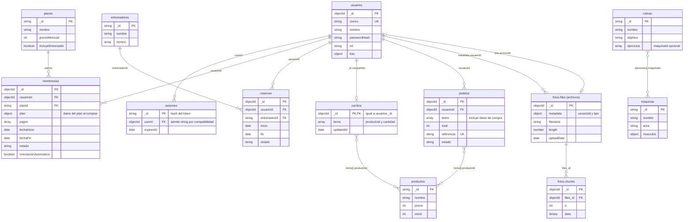

# Diagrama ER de GymFlow

Las once colecciones de aplicación se definen en [esquema.js](../backend/src/esquema.js).
GridFS guarda los archivos de fotos en dos colecciones adicionales.

Las referencias marcadas como `FK` son relaciones lógicas de MongoDB.
Cada membresía guarda sus pagos y datos del plan como subdocumentos.
Las rutinas guardan los ejercicios dentro del documento y los pedidos
conservan el nombre y precio de los productos al comprar. Una foto vigente
se identifica mediante `usuarios.foto.archivoId`. GridFS registra el dueño
en `fotos.files.metadata.usuarioId`.
