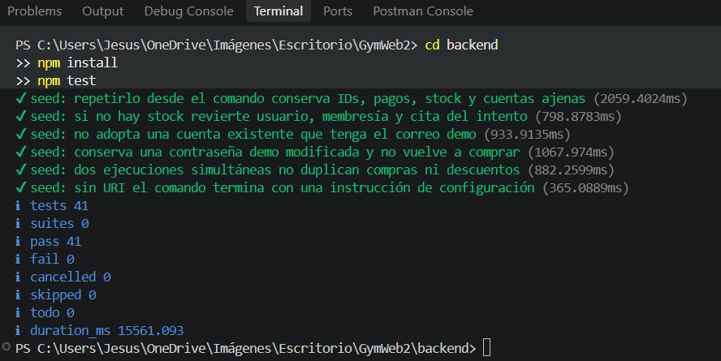

# Semana 13 — Pruebas de integración de la foto de perfil

**Responsable:** Jesús David Albarracín Ortega (Persona 3)
**Archivo:** `backend/test/api.test.js` (MongoDB en memoria con `mongodb-memory-server`)

## Pruebas agregadas

| Prueba | Qué comprueba |
|---|---|
| La subida se guarda en `fotos.files` y queda ligada al usuario | `POST /api/perfil/foto` devuelve 201, el archivo existe en GridFS y `usuarios.foto.archivoId` apunta a él |
| Al subir otra se borra la anterior | Con una segunda foto, la primera desaparece de `fotos.files` y no quedan archivos huérfanos |
| DELETE elimina la foto | `DELETE /api/perfil/foto` deja al usuario sin `foto`, borra el archivo y `GET /api/fotos/:id` responde 404 |
| Sin sesión no se puede subir | Subir sin cookie de sesión devuelve 401 |
| El validador rechaza un `telefono` inválido (código 121) | Insertando directo en `usuarios`: acepta `3001234567` y `+57 300 123 4567`; rechaza letras, menos de 7 o más de 20 dígitos, guiones y valores numéricos |

## Cómo correrlas

```
cd backend
npm install
npm test
```

## Resultado

41 pruebas, 41 pasan, 0 fallan.

